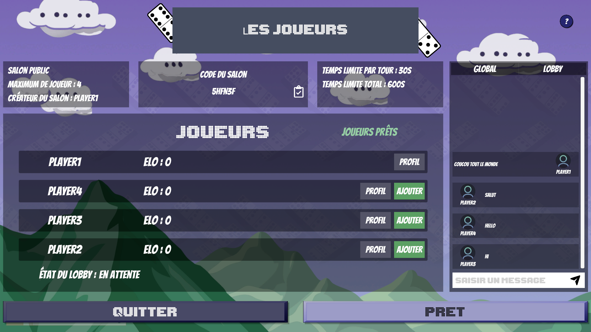
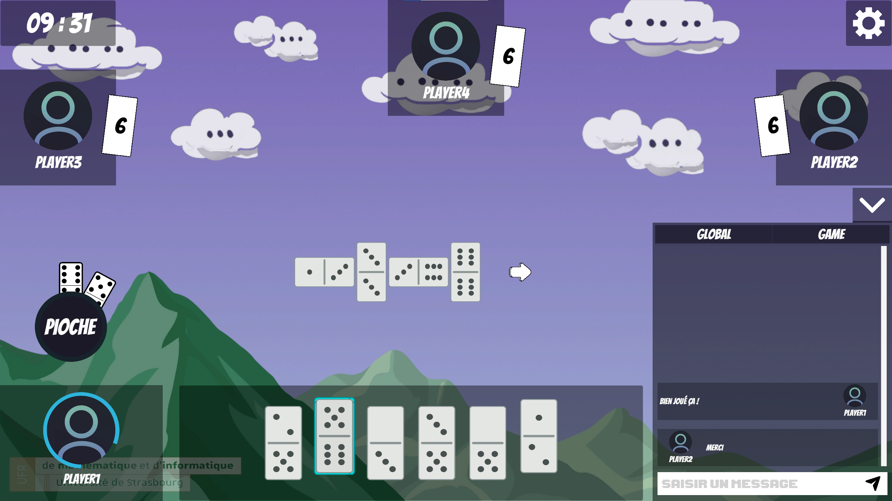

# Domino

It is a project about the game of Domino in multiplayer mode made in early **2024**. The game itself is made with Unity but the server is made with pure C#. It use TCP sockets (with SSL). The backend has a clean architecture and a lot of tests.

