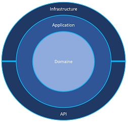
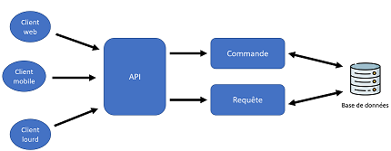

# Architectures utilisées

## Sommaire
- [Architectures utilisées](#architectures-utilisées)
  - [Sommaire](#sommaire)
  - [L'architecture en oignon](#larchitecture-en-oignon)
    - [La couche domaine](#la-couche-domaine)
    - [La couche application](#la-couche-application)
    - [La couche infrastructure / API](#la-couche-infrastructure--api)
  - [L'architecture CQRS](#larchitecture-cqrs)
    - [Le modèle "commande"](#le-modèle-commande)
    - [Le modèle "requête"](#le-modèle-requête)

## L'architecture en oignon

L'architecture en oignon, également connue sous le nom d'architecture en couches, est un style d'architecture logicielle qui organise le code en couches distinctes qui interagissent les unes avec les autres de manière hiérarchique. L'architecture en oignon facilite la maintenance, l'extensibilité et la modularité du code en séparant les préoccupations et en permettant aux développeurs de travailler sur des parties spécifiques de l'application sans affecter les autres parties. L’architecture en oignon se compose généralement de plusieurs couches.

### La couche domaine
C’est la couche centrale de l’oignon, elle est chargée de représenter les concepts métiers de l'application et contient donc les règles métiers de l'application, ainsi que les
80
entités métiers qui les représentent. Cette couche est indépendante de toutes les autres couches, elle ne doit donc pas contenir de code qui dépend des autres couches.

L'un des avantages clés de la couche du domaine est qu'elle est conçue pour être réutilisable et facilement testable, car elle ne dépend pas des détails d'implémentation des autres couches. Cela permet également de faciliter l'évolution de l'application, car les modifications apportées aux autres couches n'affectent pas directement la couche du domaine.

### La couche application
La couche d'application est la couche intermédiaire de l'architecture en oignon. Elle représente le coeur de la logique métier de l'application. Cette couche gère toutes les opérations et traitements liés à la logique métier de l'application, indépendamment des détails d'implémentation et de la technologie utilisée pour l'interface utilisateur ou la base de données.

Dans cette couche, il faut concevoir et implémenter des services qui répondent aux besoins de l'application. Les services peuvent être appelés par la couche d'interface utilisateur (application web ou mobile) ou par la couche d'infrastructure pour récupérer, traiter et manipuler les données.

### La couche infrastructure / API
La couche d'infrastructure ou d'API de l'architecture en oignon est la couche la plus basse. Elle gère toutes les interactions avec des ressources externes, telles que les bases de données, les services web, les systèmes de fichiers… Cette couche est responsable de l'implémentation des détails techniques de l'application, en fournissant une API pour que les couches supérieures puissent interagir avec ces ressources externes. Dans cette couche, on retrouve généralement des composants qui interagissent avec les bases de données comme un ORM, ainsi que les composants qui interagissent avec des services web, tels que les clients HTTP.

## L'architecture CQRS

L'architecture CQRS (Command Query Responsibility Segregation) est une architecture logicielle qui consiste à séparer les opérations de commande (écriture) et de requête (lecture) en deux modèles distincts. Le principe de base est que les opérations de lecture sont très différentes des opérations d'écriture et qu'elles nécessitent des traitements différents.

### Le modèle "commande"
La commande ou « Command » (en anglais) est une demande de modification de l’état du système. Les commandes sont émises par les couches supérieures de l'application et sont ensuite traitées par la couche de commande de l'application, qui les envoie aux gestionnaires de commandes appropriés. Les commandes peuvent être utilisées pour créer, mettre à jour ou supprimer des entités du domaine mais aussi pour déclencher des actions plus complexes.

### Le modèle "requête"
La requête ou « Query » (en anglais) est une demande de lecture de l’état du système, elle est responsable de la récupération des données du système et de les présenter à l'utilisateur, elle ne doit donc pas modifier l’état du système. Cette entité peut prendre différentes formes en fonction des besoins du système, mais elle est généralement conçue pour être légère, performante et flexible.

